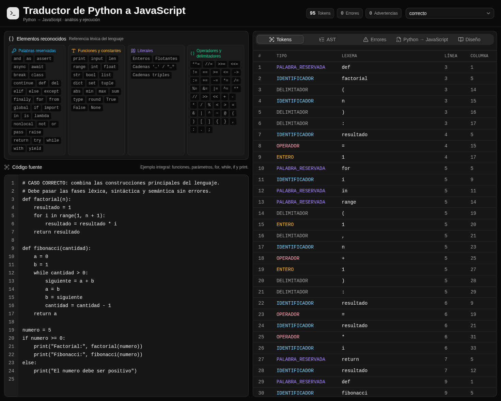

# Traductor de Python a JavaScript

Proyecto educativo que analiza un subconjunto de Python y, si el programa es válido, genera su traducción a JavaScript. La interfaz permite explorar los tokens, el árbol de sintaxis abstracta, los diagnósticos y el código generado; también permite comprobar y ejecutar la traducción.

## URL del proyecto

[Traductor de Python a JavaScript](https://proyecto-complilador.vercel.app)

## Preview

## Documento de diseño

### Propósito y funcionamiento general

El proyecto funciona como un **traductor de lenguajes de programación**: recibe código fuente escrito en un subconjunto de Python, analiza sus componentes y su estructura, comprueba aspectos semánticos y genera un programa equivalente en JavaScript para las construcciones admitidas. La traducción solo se produce cuando no hay errores bloqueantes. Por eso, no es únicamente un detector de errores ni un intérprete de Python: su resultado principal es código en otro lenguaje.

El recorrido de un programa es:

1. El usuario escribe código en el editor o carga un ejemplo.
2. El coordinador (`lib/analyzer/index.ts`) ejecuta el análisis léxico, sintáctico y semántico.
3. Los resultados se presentan en los paneles de tokens, AST y diagnósticos.
4. Si las fases no detectan errores bloqueantes, el generador produce JavaScript. La interfaz permite comprobar su sintaxis, ejecutarlo y consultar la salida capturada.

### 1. Análisis léxico — `lexer.ts`

El lexer lee el texto de izquierda a derecha y lo divide en unidades llamadas **tokens**. Cada token conserva su tipo, lexema y ubicación (línea y columna), lo que permite mostrar resultados y localizar errores con precisión.

- Reconoce palabras reservadas, identificadores, números enteros y flotantes, cadenas, operadores y delimitadores.
- Aplica *maximal munch*: cuando varios operadores comparten un prefijo, intenta reconocer primero el más largo (por ejemplo, `**=` antes que `*`).
- Emula la sangría de Python mediante una pila de niveles que genera `INDENT` y `DEDENT`; dentro de delimitadores ignora los saltos de línea para este conteo.
- Detecta caracteres inválidos, cadenas sin cerrar y literales numéricos mal formados, informando la posición del problema.

### 2. Análisis sintáctico — `parser.ts`

El parser comprueba que los tokens estén organizados según la gramática implementada. Utiliza **descenso recursivo** y niveles de precedencia para interpretar expresiones, desde operadores lógicos y comparaciones hasta operaciones aritméticas y expresiones postfijas.

- Construye un **árbol de sintaxis abstracta (AST)**: una representación estructurada del programa que conserva tipos de nodo, etiquetas y posiciones.
- Procesa las sentencias y expresiones admitidas por el subconjunto, entre ellas asignaciones, condicionales, ciclos, definiciones de funciones y clases, retornos, llamadas, listas, diccionarios e indexación.
- Ante ciertos errores sintácticos, descarta tokens hasta un límite seguro para intentar reportar otros problemas en el mismo análisis.

### 3. Análisis semántico — `semantic.ts`

El análisis semántico recorre el AST y verifica aspectos que no se resuelven comprobando únicamente la gramática. Mantiene ámbitos anidados y registra definiciones para revisar el uso de variables y funciones.

- Detecta variables usadas antes de definirse y destinos de asignación inválidos.
- Comprueba la cantidad de argumentos de funciones conocidas, considerando parámetros con valores por defecto.
- Reporta `return` fuera de una función y `break` o `continue` fuera de un ciclo.
- Señala la redefinición de funciones como advertencia.

### 4. Generación de código — `codegen.ts`

Cuando el AST supera las validaciones bloqueantes, el generador lo recorre y produce JavaScript para las construcciones que puede traducir. Utiliza convenciones y funciones auxiliares para resolver diferencias de comportamiento entre Python y JavaScript. Si encuentra una construcción no traducible, informa el motivo en lugar de presentar una traducción incompleta.

La interfaz deja revisar el resultado, verificar que sea JavaScript sintácticamente válido y ejecutarlo capturando su salida. Esta verificación permite probar el código generado; no implica que el proyecto ejecute directamente el programa fuente de Python.

### Alcance del lenguaje

El proyecto implementa un **subconjunto educativo**, no la especificación completa de Python. La referencia «Elementos reconocidos» muestra el vocabulario léxico implementado —palabras reservadas, funciones incorporadas, constantes, tipos de literales, operadores y delimitadores—. Que una palabra sea reconocida por el lexer no significa necesariamente que el parser admita todas las construcciones asociadas a ella o que el generador pueda traducirlas.

### Decisiones de diseño

- Separar lexer, parser, análisis semántico y generación de código en módulos facilita su comprensión, mantenimiento y prueba.
- Conservar la línea y columna en tokens y nodos permite ofrecer diagnósticos precisos y relacionarlos con el código fuente.
- Intentar recuperarse de errores en lugar de detener todo el análisis ante el primer problema entrega diagnósticos más útiles.
- Mantener visible cada etapa hace que el proyecto sirva como material didáctico para explicar cómo un traductor transforma un lenguaje de programación en otro.
